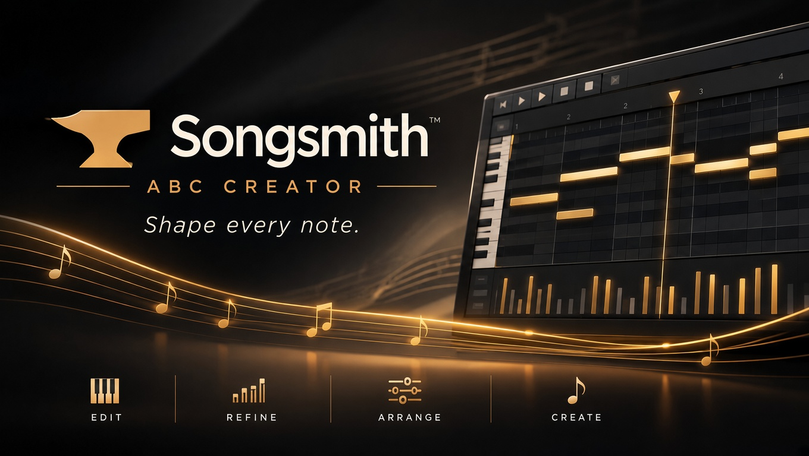

  

# Songsmith

**Songsmith** is a Windows MIDI editor and ABC creator for *The Lord of the Rings Online*. Open any MIDI file, shape it in a piano-roll editor, hear it through LOTRO-style instrument sounds, and render a LOTRO-ready ABC file that keeps the feel, beat and rhythm of your music.

> Songsmith is a work in progress and is shared for early testing. Feedback is welcome; see [Feedback](#feedback).

## Why Songsmith

The MIDI is the source of truth. Songsmith makes as few decisions for you as it can: the ABC reflects your MIDI as literally as LOTRO's format allows, and it only changes things when LOTRO forces it (the instrument's playable range, the 6-note chord limit, one tempo and meter per part). No hidden smoothing or clean-up passes. If the MIDI has detail, the ABC shows it.

## Features

### Edit
- Piano-roll MIDI editor with velocity and pitch-bend lanes, grid and swing, snap to grid and snap to key
- Quantize, Humanize, Transpose and Bake Pitch Bends, each with a live preview and a single undo step
- Split, join, legato, copy and paste across tracks, and track sections you can move, resize and delete
- Tempo and meter editor with a multi-meter ruler, and key detection for the song

### Refine
- Instrument card per part: transpose, volume, delay, usable range and chord-note filters
- **Note Maps** for pitched instruments, and **Drumsmith**, a drum-kit editor for mapping GM drums to LOTRO drum sounds (Maestro `.txt` import and export)
- **Chordsmith**: turn big chords into 1 to 6 notes you choose, to stay under LOTRO's 64-note polyphony cap
- Range band always shown, so out-of-range notes are visible while you edit

### Arrange
- Dockable panels: Parts, MIDI Editor, LOTRO Preview, Mixer, ABC Mixer, Volume, Level Meter and Loudness Timeline, with layouts you can save
- Song-wide fade-in and fade-out
- **Song Versions**: keep named variations of one song in a single `.songsmith` file
- Loop ranges, playback rate, and mute and solo per track

### Create
- Playback in two modes: plain MIDI, or **LOTRO** mode using LOTRO instrument sounds at your written dynamics
- Loudness meter per part, coloured against each instrument's measured dynamic thresholds
- **Render** to LOTRO ABC, WAV, FLAC, Ogg Vorbis, MP3 (needs `lame` installed) or MIDI, with diagnostics and a polyphony histogram
- Seventeen built-in themes plus your own custom themes, and hover tips you can turn down or off

## Download

1. Open the [Releases](../../releases) page and download the latest `song-smith-windows.zip`.
2. Unzip it anywhere and double-click `song-smith.exe`.

Playback works out of the box with the bundled General MIDI SoundFont. For LOTRO instrument sounds, download `SongSmith-LOTRO.sf2` from the [SoundFonts release](../../releases/tag/soundfonts), then put it in the `resources` folder next to `song-smith.exe`.

Windows only (64-bit).

## Quick start

1. **File → Import → MIDI…** and pick a MIDI file.
2. Double-click a track row to open it in the editor. Fix notes, quantize, or transpose.
3. Assign each part a LOTRO instrument on the instrument card. Press **Space** to listen; switch the transport toggle to **LOTRO** to hear it with LOTRO sounds.
4. **Song → Render…** (`F5`) to write the ABC. `F6` repeats your last render with no questions.
5. **File → Save** keeps everything, including your edits and settings, in a `.songsmith` file.

## Command-line converter

The zip also includes `engines/forge.exe`, the converter that Songsmith uses. Run `forge.exe --help` to convert MIDI to ABC from a terminal.

## Feedback

Please open an [issue](../../issues) with what you were doing, what you expected, and what happened. A short MIDI file that shows the problem helps a great deal.

For questions, help and general discussion, join the [Songsmith Discord](https://discord.gg/mXJqBwhfmG).

## Credits and licences

- The bundled playback SoundFont is the GPL-2 TimGM6mb bank, renamed `SongSmith.sf2`. Its licence text and notice are in the zip under `licenses/`.
- `SongSmith-LOTRO.sf2` is derived from the LOTRO instrument bank in Maestro, credited to Standing Stone Games.
- Built with [JUCE](https://juce.com) and [TinySoundFont](https://github.com/schellingb/TinySoundFont) (MIT).

*The Lord of the Rings Online* is a trademark of Standing Stone Games. Songsmith is an independent fan tool and is not affiliated with or endorsed by Standing Stone Games, Middle-earth Enterprises or the Tolkien Estate.
